<div align="center">

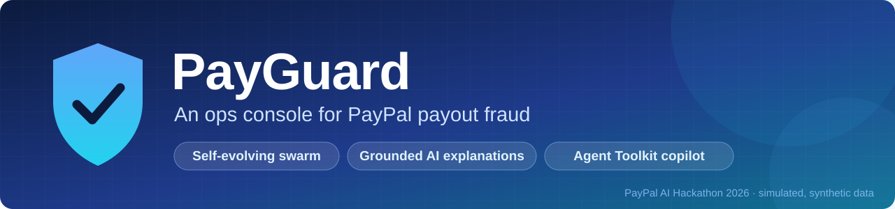

<h1>PayGuard Arena</h1>

<br>

<p><a href="https://payguard-arena.onrender.com"><strong>▶ Launch live demo</strong></a> &nbsp;·&nbsp;
<a href="https://www.youtube.com/watch?v=JgTeyIBjaaE">Watch demo (2:21)</a> &nbsp;·&nbsp;
<a href="#results">Explore blind-test results</a></p>

<p><sub><strong>STACK</strong></sub><br>


</p>

<p><sub><strong>AI + PAYMENTS</strong></sub><br>
<a href="https://github.com/paypal/agent-toolkit"></a>

</p>

<p><sub><strong>PROJECT</strong></sub><br>
<a href="LICENSE"></a>
</p>

<p><strong>A self-evolving swarm holds risky payouts. An Agent Toolkit copilot explains why.<br>Tested blind 3 times: 1 fail, 1 pass, 1 negative result.</strong></p>

<a href="#-the-product">Product</a> ·
<a href="#-see-it-in-action">Screenshots</a> ·
<a href="#-how-it-works">How it works</a> ·
<a href="#results">Results</a> ·
<a href="#-quick-start">Quick start</a> ·
<a href="#-how-paypal-and-ai-are-used">PayPal & AI</a>

</div>

<br>

<div align="center">
<picture>
  <source media="(prefers-color-scheme: dark)" srcset="docs/images/g2-console-dark.jpg">
  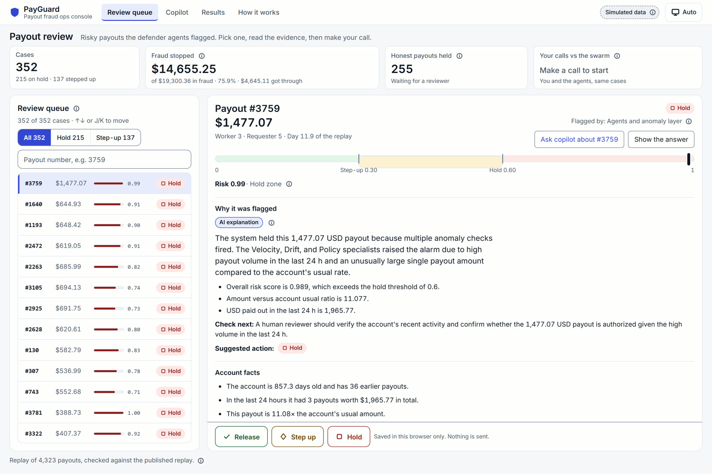
</picture>
<sub><b>Review queue.</b> 352 payouts the swarm held or stepped up, holds first. Each case shows the risk, the agents' votes and a grounded AI explanation.</sub>
</div>

> [!IMPORTANT]
> **Simulated, synthetic data.** Built for the PayPal AI Hackathon (Nov 2026). Every number here comes from a **simulated replay on synthetic data**, never real fraud data. Only a few USD 1.00 test payouts went through the real PayPal **sandbox**. Three pre-registered tests were run, each once, on a sealed attack family: **round 1 failed (NO-GO)**; **round 2 passed (GO), with caveats**; **round 3 passed H1 but failed H2**, because its world model made the defender worse. See [Results](#results).

## ✨ At a glance

<table>
<tr>
<td width="50%" valign="top">

### 🛡️ Holds risky payouts
Four specialist agents score every instant payout. **Release, step-up or hold**, with holds and the most dollars at risk first in the queue.

</td>
<td width="50%" valign="top">

### 💬 Explains every hold
Gemini writes a plain-English reason from decision-time evidence only. A **grounding check** rejects any number it cannot trace.

</td>
</tr>
<tr>
<td width="50%" valign="top">

### 🤖 Agent Toolkit copilot
Ask ops questions against the **PayPal sandbox**. Read-only tools; every tool call shows its source.

</td>
<td width="50%" valign="top">

### 🧪 Tested blind, 3 times
Pass rule written first, sealed attack family, run once. **We publish the fail and the negative result too.**

</td>
</tr>
</table>

|  | Round 1 · sleeper | Round 2 · account takeover | Round 3 · synthetic-identity farm |
| --- | :---: | :---: | :---: |
| **Verdict** |  |  |  |
| **Tested defender** (lower is better) | 80.56 | 26.30 | 49.57 |
| **Static rules** | 28.54 | 52.21 | 103.37 |
| **What it means** | Static rules beat us | The swarm design wins on a shared-channel family | Beats baselines, but dreaming made it worse |

<sub>Objective = leakage % + 0.5 × honest block % + honest unpaid %. Simulated replay, 20 episodes per round. Full tables and caveats in [Results](#results).</sub>

## 📚 Navigate

**Pick a path**

- **Judges:** [At a glance](#-at-a-glance) · [Results](#results) · [Objective chart](#objective-visualization) · [Round 1](#round-1-held-out-sleeper-family) · [Round 2](#round-2-second-sealed-family) · [Round 3](#round-3-the-swarm-that-dreams-and-doubts)
- **Developers:** [Quick start](#-quick-start) · [Architecture](#-architecture) · [Request lifecycle](#request-lifecycle) · [Offline evolution loop](#offline-evolution-loop) · [Replay and sandbox boundaries](#replay-and-sandbox-boundaries) · [How it works](#-how-it-works) · [Repository map](#-what-is-in-the-repo-today)
- **Product users:** [Live demo](https://payguard-arena.onrender.com) · [Demo video](#-demo-video) · [Screenshots](#-see-it-in-action) · [Product views](#-the-product)
- **Researchers:** [Benchmark protocol](#-simulator-and-benchmark-protocol) · [Metrics](#metrics) · [Splits](#protocol-splits) · [Baselines](#baselines) · [Reproduction](#how-to-reproduce) · [Limits](#limits)

<details>
<summary><strong>Full section index</strong></summary>

- [Demo video](#-demo-video)
- [At a glance](#-at-a-glance)
- [Quick start](#-quick-start)
  - [Local setup and sandbox smoke tests](#local-setup-and-sandbox-smoke-tests)
  - [Dashboard](#dashboard)
  - [Ops copilot](#ops-copilot)
  - [Deploy](#deploy)
- [See it in action](#-see-it-in-action)
- [Architecture](#-architecture)
  - [Request lifecycle](#request-lifecycle)
  - [Offline evolution loop](#offline-evolution-loop)
  - [Replay and sandbox boundaries](#replay-and-sandbox-boundaries)
- [The product](#-the-product)
- [How it works](#-how-it-works)
- [Simulator and benchmark protocol](#-simulator-and-benchmark-protocol)
  - [What a defender sees](#what-a-defender-sees)
  - [Honest population and hard negatives](#honest-population-and-hard-negatives)
  - [Attack families](#attack-families)
  - [Verdicts and their costs](#verdicts-and-their-costs)
  - [Metrics](#metrics)
  - [Protocol splits](#protocol-splits)
  - [Baselines](#baselines)
  - [Freeze](#freeze)
  - [Honesty note](#honesty-note)
- [Results](#results)
  - [Summary](#summary)
  - [Objective visualization](#objective-visualization)
  - [Objective and pass rule](#objective-and-pass-rule)
  - [Round 1: held-out sleeper family](#round-1-held-out-sleeper-family)
  - [Round 2: second sealed family](#round-2-second-sealed-family)
  - [Round 3: the swarm that dreams and doubts](#round-3-the-swarm-that-dreams-and-doubts)
  - [LIVE rows (PayPal sandbox)](#live-rows-paypal-sandbox)
  - [How to reproduce](#how-to-reproduce)
  - [Limits](#limits)
- [What is in the repo today](#-what-is-in-the-repo-today)
- [How PayPal and AI are used](#-how-paypal-and-ai-are-used)
- [License](#-license)

</details>

## 🎬 Demo video

<div align="center">
<a href="https://www.youtube.com/watch?v=JgTeyIBjaaE">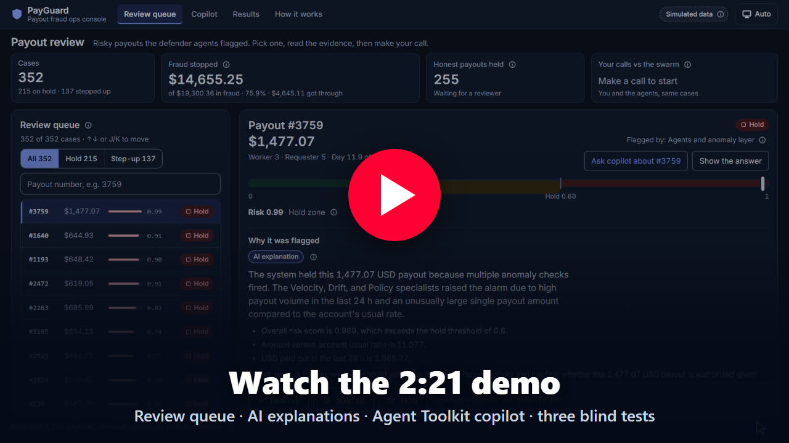</a>
<br><sub>2:21 on YouTube: the review queue, a held payout and its AI explanation, the live copilot run, and the three blind tests.</sub>
</div>

<div align="center">
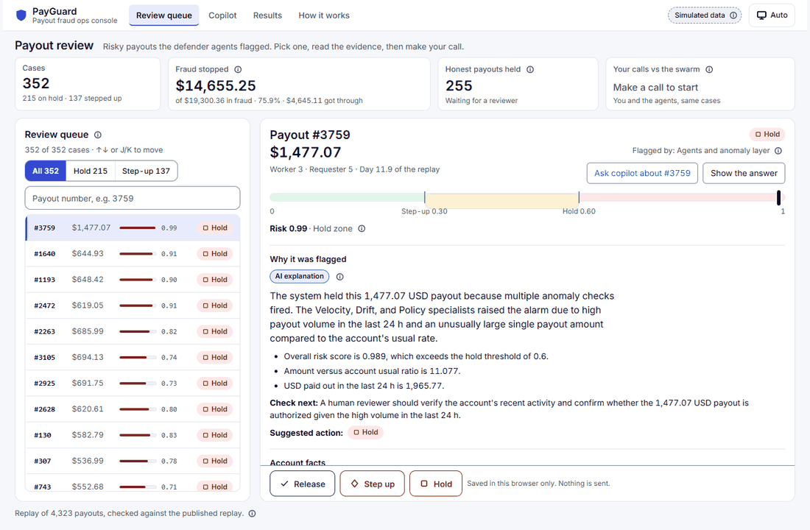
<br><sub>Captured from the deployed app. The review queue uses replay data; the copilot view is a recorded session. This walkthrough triggers no live tool calls or payments.</sub>
</div>

## 📸 See it in action

<table>
<tr>
<td width="50%">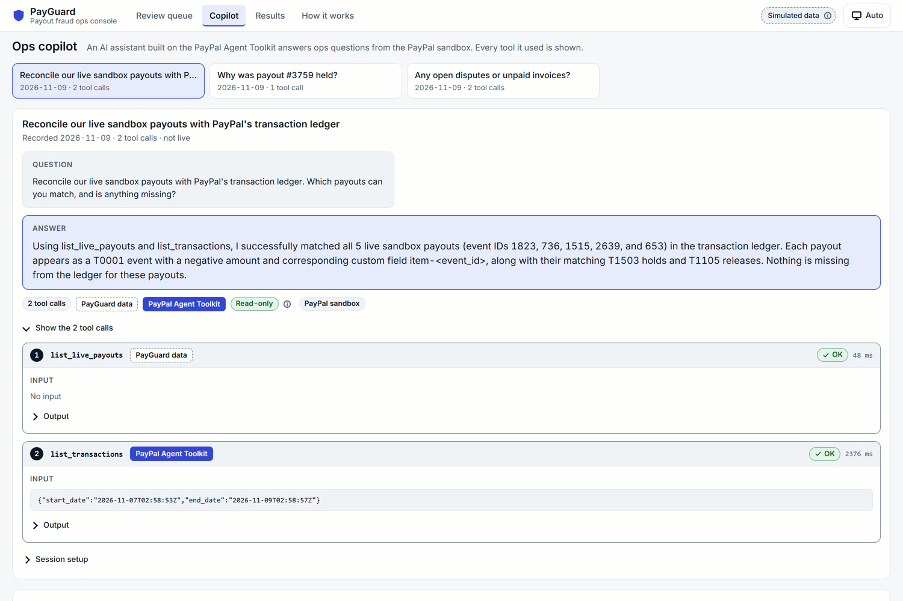<br><sub>🤖 <b>Copilot</b> on the PayPal Agent Toolkit: matched all 5 live sandbox payouts to PayPal's transaction ledger.</sub></td>
<td width="50%">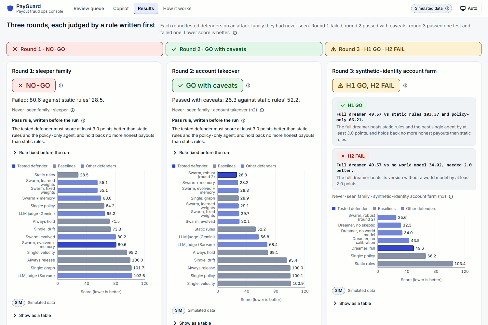<br><sub>🧪 <b>Results</b>: three blind tests, each judged by a rule written first.</sub></td>
</tr>
<tr>
<td width="50%">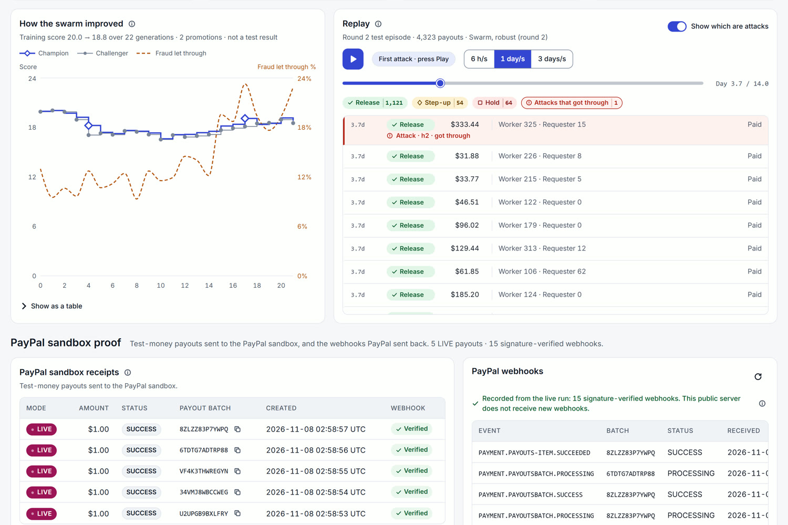<br><sub>🧬 <b>How it works</b>: the swarm's evolution (champion vs challenger) and a replay of the round-2 test.</sub></td>
<td width="50%">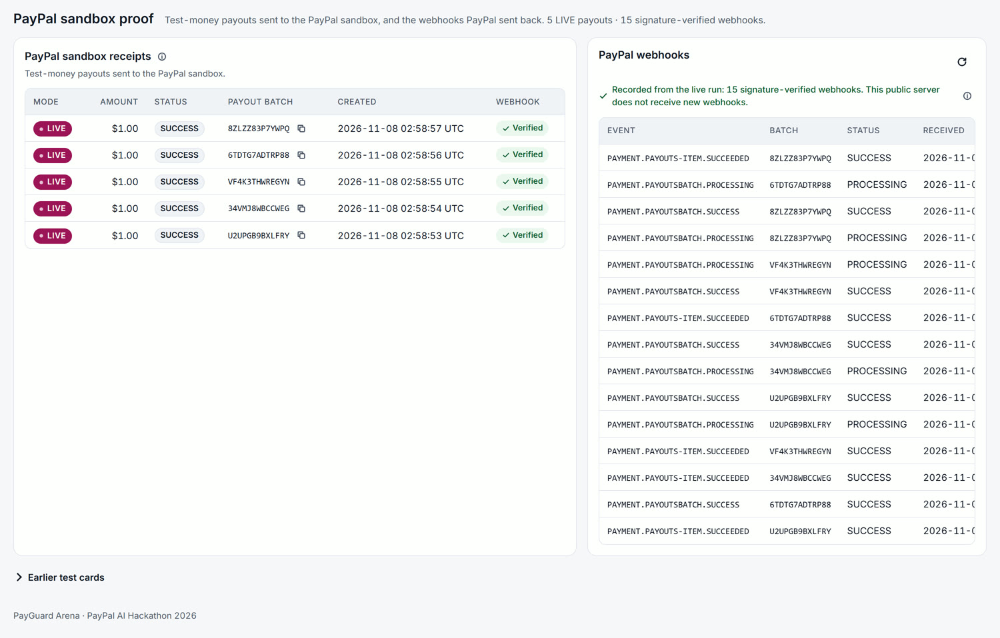<br><sub>💸 <b>PayPal sandbox proof</b>: 5 live USD 1.00 test payouts, all SUCCESS, 15 signature-verified webhooks.</sub></td>
</tr>
</table>

## 🚀 Quick start

### Local setup and sandbox smoke tests

```bash
python -m venv .venv
.venv\Scripts\activate          # Windows; use source .venv/bin/activate elsewhere
pip install -e ".[dev]"
pytest                           # offline, needs no keys
cp .env.example .env             # then fill in your own sandbox credentials
python -m scripts.smoke_paypal_payouts
python -m scripts.smoke_sarvam
```

### Dashboard

Dashboard (no keys needed). It replays the file in `PAYGUARD_REPLAY_PATH`, else `eval/replay_live.json`, else `eval/replay.json`, else the sample fixture:

```bash
uvicorn payguard.api.app:app --port 8000        # serves the API and the built UI at http://127.0.0.1:8000
cd web && npm ci && npm run dev                 # UI development server, proxies /api to port 8000
cd web && npm run build                         # rebuild web/dist (commit it; the deploy has no Node)
```

### Ops copilot

Ops copilot (local, read-only, PayPal sandbox). Your sandbox app needs Transaction Search and Invoicing enabled, and `.env` needs `PAYPAL_CLIENT_ID`, `PAYPAL_CLIENT_SECRET` and `GEMINI_API_KEY` (or `SARVAM_API_KEY`):

```bash
pip install -r requirements-copilot.txt
pip install --no-deps paypal-agent-toolkit==1.11.0
python -m scripts.copilot check                # prints only "sandbox auth OK" or the error name
python -m scripts.copilot ask "Reconcile our live sandbox payouts with PayPal's transaction ledger"
```

### Deploy

Deploy (Render, Python only, no secrets needed for Replay mode): build `pip install -r requirements.txt`, start `uvicorn payguard.api.app:app --host 0.0.0.0 --port $PORT`, health check `/api/health`.

The PayPal webhook (`POST /webhooks/paypal`) accepts nothing until `PAYPAL_WEBHOOK_ID` is set: it returns 503, and every event is checked with PayPal's verify-webhook-signature API before it changes a receipt.

## 🏗️ Architecture

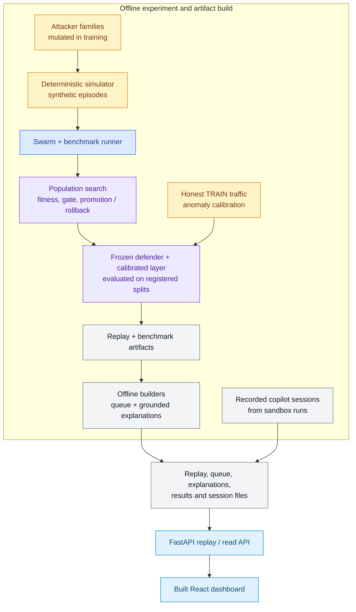

The deployed dashboard is a **replay viewer**, not a live inference service: it reads the replay and prebuilt console, explanation, results and copilot-session artifacts. It does not score incoming production payouts or send PayPal payouts. The copilot sessions displayed there are recordings; the separately run local copilot uses read-only sandbox tools.

### Request lifecycle

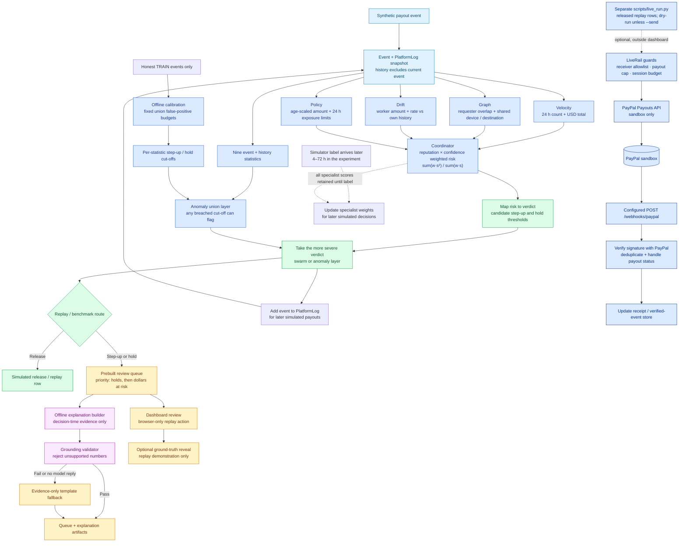

The four specialists share the event history but look through different lenses. A zero score abstains from the coordinator vote rather than diluting another specialist's signal. The default step-up and hold thresholds are 0.30 and 0.60; evolution can tune a candidate's thresholds. In the benchmark runner, labels are delivered after the event; no label or outcome is available to the decision-time scorers or explanation builder. The live rail is an explicit, separate script—not a branch the hosted replay dashboard can invoke.

### Offline evolution loop

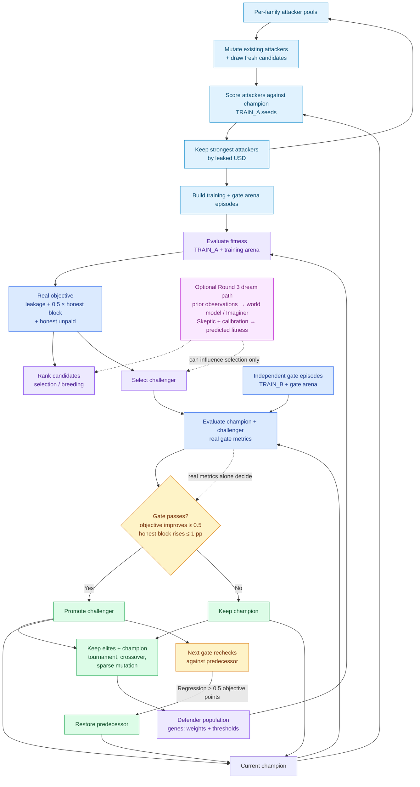

The dream path is optional and can affect candidate ranking, but promotion and rollback use real gate-set objectives. The Round 3 world-model experiment did not improve the sealed result; see [Round 3](#round-3-the-swarm-that-dreams-and-doubts).

### Replay and sandbox boundaries

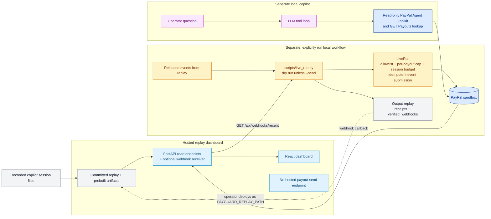

## 📦 The product

Instant payouts are what gig workers want, and what fraud rings want too: once the money is out, it is gone. PayGuard decides **release, step-up or hold** for every payout and gives the human reviewer the reasons.

| View | What you can do |
| --- | --- |
| **Console** (`#/console`, the default) | Work the review queue: the 352 payouts that the swarm held (215) or stepped up (137) in one published replay episode (TEST_HELDOUT2 seed 4000, 4,323 payouts). Holds come first, then the largest expected dollars at risk (risk x amount). Each case shows the risk meter, which specialist spoke up and how much its vote counted, the anomaly statistics that fired, the account facts, and an AI explanation. In replay mode you can keep a payout on hold or release it, and then see the simulator's ground truth. |
| **Copilot** (`#/copilot`) | Sessions recorded live on the PayPal sandbox. An LLM agent calls read-only PayPal Agent Toolkit tools (transactions, disputes, invoices, orders), our own read-only Payouts lookup and the console data. Every tool call shows its source. No key is exposed on the site. |
| **Results** (`#/results`) | The three pre-registered rounds side by side: tables, verdicts, caveats, and the round-3 dreamer panel (paired differences with 95% intervals). |
| **How it works** (`#/how`) | The decision feed, the evolution chart (champion vs challenger), live sandbox payout receipts and signature-verified webhooks. |

In that episode, attack payouts worth USD 19,300.36 were requested. The swarm stopped USD 14,655.25 of it (76%) and USD 4,645.11 leaked (simulated).

## 🔧 How it works

1. **A swarm of specialists.** Four agents score every payout from 0 to 1: Velocity (count and volume in the last 24 h), Graph (accounts tied to the same requester, device or payout destination), Drift (rate against the account's own normal) and Policy (amount against the limit for the account's age). The coordinator combines them as risk = sum(w*s^2) / sum(w*s). It steps up at 0.3 and holds at 0.6. An anomaly layer of nine statistics, with cut-offs learned from honest traffic only, can raise the verdict but never lower it.
2. **Self-evolution.** A genetic population search evolves the swarm's weights and thresholds against attackers that mutate their own tactics. A challenger replaces the champion only if it wins on held-out training seeds (a champion-challenger gate). Round 3 added a world model of the attackers, a dream loop and a Skeptic. On the sealed test that addition made things worse, and we report it that way ([Round 3](#round-3-the-swarm-that-dreams-and-doubts)).
3. **AI explanations, checked.** Offline, an LLM (Google `gemini-3.5-flash-lite`) writes a plain-language reason for each held payout. It sees only what was known when the payout was decided (scores, weights, vote shares, anomaly statistics, account facts), never the ground truth or the outcome. A grounding check requires every number in the text to appear in that evidence. If any number fails, the console shows a fixed template instead and labels it as one (`payguard/console/explain.py`).
4. **An ops copilot on the PayPal Agent Toolkit.** An LLM tool loop (`payguard/copilot/`) over the framework-agnostic `shared` layer of `paypal-agent-toolkit` 1.11.0.
   - **Read-only.** Six read-only tools are enabled: list_transactions, list_disputes, get_dispute, list_invoices, get_invoice, get_order_details. The HTTP client handed to the Toolkit refuses POST, PUT and DELETE and any non-sandbox host.
   - **Payouts.** The Toolkit has no Payouts tools, so payout batch status comes from our own read-only `GET /v1/payments/payouts/{id}`.
   - **Privacy.** Personal data (emails, names, addresses, payer ids) is redacted before the model sees it and before a session is saved.
5. **PayPal rails.** Released payouts can be paid as real sandbox Payouts batches through a guarded live rail (per-payout cap, session budget, receiver allowlist). PayPal's webhooks are verified with `verify-webhook-signature` before they change a receipt.

## 🎲 Simulator and benchmark protocol

The simulator is a deterministic synthetic gig-payout platform. For a given seed it builds the same episode every time: 14 simulated days, 300 honest workers, 60 requesters and 6 small shops (`SimConfig` in `payguard/sim/engine.py`), plus 2-4 attack campaigns.

Run the offline checks and the baselines from the repo root:

```bash
python -m pytest -q
python -m scripts.run_baselines
```

### What a defender sees

- Each payout request is an `Event`: time in hours, worker, requester, device, payout destination and USD amount.
- A defender can also compute features from the platform's own prior history (account age, amounts in the last 24 h, how many workers share a device, destination or requester). See `payguard/sim/features.py`.
- Ground truth (`Truth`: is_attack, family, campaign id) is never shown to a defender. It reaches the defender only as a delayed label through `learn()`, after the outcome is known.
- Resolution randomness is keyed by (episode seed, event id), not by call order. A defender that decides differently does not change the draws seen by later events.

### Honest population and hard negatives

Honest workers come in four personas (share of workers in brackets):

- `regular` (60%): about 0.6 payouts a day.
- `new` (15%): accounts 0-10 days old, about 1 payout a day.
- `power` (8%): about 3 payouts a day, larger amounts.
- `bursty` (17%): quiet most days; on about a quarter of days, 3-6 payouts land within that day.

Amounts are lognormal and clipped to USD 5-1,500, so some honest payouts are above the USD 500 review threshold.

Hard negatives, so that flagging anything unusual is not enough:

- Small shops: groups of 3 workers who are all paid by one shop requester. A graph rule may see them as a ring.
- Family sharing: some pairs of workers share a device (pairs numbering 2.5% of workers) or a payout destination (1.5%).

### Attack families

Attackers are parameterized generators. They are not an LLM. `sample_params` draws parameters uniformly within bounds, and `mutate` in `payguard/sim/attacks.py` jitters them within the same bounds.

- **ring:** 4-30 accounts (default 12), each with its own device and destination, normal amounts and rate, and aged accounts. Each account is clean on its own. The only signal is shared structure: the ring's workers are paid by the same small set of 1-5 requesters.
- **structuring:** 1-4 young accounts make bursts of 2-6 payouts within 1-12 hours. Each payout is just under the USD 500 review threshold (by 1-60 USD).
- **sleeper (held out):** 1-4 accounts behave honestly for 2-9 days, then make 2-6 cash-outs spaced 2-36 hours apart. Each cash-out is 3-12 times the account's own baseline, capped at USD 450, so it stays under the threshold. Only the cash-outs count as attack (loss); the trust-building payouts before them are labelled honest, because in a real bust-out they produce no chargebacks, so no fraud label can reach a defender before the cash-out starts. This family is used only for the held-out split.
- **h2, account takeover (sealed, round 2):** a crew takes over aged worker accounts (60-600 days) in one wave and drains their pending earnings. Amounts stay ordinary for the victim (about 1-4x its own median) and under the review threshold by a margin. The payouts go to 1-3 shared cash-out destinations from 1-3 attacker devices, while requesters look normal. It was written by a separate worker who never saw the round-2 defender, frozen by hash, and never built before that defender was frozen (`payguard/heldout2/`, design note `docs/HELDOUT2_FAMILY.md`). It is used only for TEST_HELDOUT2.
- **h3, synthetic-identity account farm (sealed, round 3):** disposable accounts are seasoned for more than a day, then each cashes out a few flat, moderate payouts. They are linked only through shared devices and payout destinations. It was built blind by a separate worker, frozen by hash (`eval/FROZEN_R3.json`), and never built before the round-3 defenders were frozen (`payguard/heldout3/`, design note `docs/HELDOUT3_FAMILY.md`). It is used only for TEST_HELDOUT3.

### Verdicts and their costs

Every event gets one verdict. Costs are defined in `payguard/sim/engine.py`:

- **RELEASE:** paid immediately. The label arrives 72 h after the request.
- **STEP_UP:** the requester must pass extra verification, which takes 4 h. The pass rate depends on the true type: honest 95%, ring 50%, sleeper 35%, structuring 20%. A pass is paid at 4 h. A fail is never paid. The label arrives 72 h after a pass and 4 h after a fail.
- **HOLD:** human review with a 24 h turnaround. The reviewer is correct 90% of the time. A correct review pays honest payouts and blocks attacks. A wrong review does the reverse. Every HOLD label arrives 24 h after the request.

For block-rate metrics, HOLD and STEP_UP both count as "blocked". Only RELEASE does not.

### Metrics

Defined in `payguard/sim/metrics.py`. All are computed over replayed episodes:

- `leakage_pct`: attack USD that was actually paid, as a share of all attack USD. Also reported per family, with `leaked_usd`.
- `honest_block_rate`: share of honest payouts that were not released instantly.
- `honest_unpaid_rate`: share of honest payouts that were never paid (failed step-up or wrong review).
- `honest_median_ttp_h` and `honest_p95_ttp_h`: hours from request to payment, for honest payouts that were paid.
- `immunity_attempts`: mean number of attack payouts that succeed in a campaign before it is contained.
- `never_contained_rate`: share of campaigns that are never contained.

Containment: a campaign is contained at the first point after which 3 consecutive payouts of that campaign are all blocked (HOLD or STEP_UP, even if a STEP_UP payout is later paid). A campaign with fewer than 3 payouts needs all of them blocked. Payouts paid before that point count as leaks. A campaign that is never contained counts all of its paid payouts as leaks.

### Protocol splits

Defined in `payguard/protocol.py`. Each episode has 2-4 campaigns. They are picked round-robin from the split's families, starting at a random family, with parameters drawn uniformly within bounds.

| Split | Seeds | Families | Intended use (from the module docstring) |
| --- | --- | --- | --- |
| TRAIN | 1000-1019 | ring, structuring | may be used for tuning |
| TEST_SEEN | 2000-2019 | ring, structuring | same families, unseen seeds |
| TEST_HELDOUT | 3000-3019 | sleeper only | unseen family, never used for tuning |
| TEST_HELDOUT2 | 4000-4019 | h2 only | round 2: second sealed family (`payguard/heldout2/protocol.py`); a test tripwire refuses these seeds |
| TEST_HELDOUT3 | 5000-5019 | h3 only | round 3: third sealed family (`payguard/heldout3/protocol.py`); never used for tuning |

### Baselines

Two trivial bounds frame every result:

- `always_release`: RELEASE every payout. Zero friction, maximum leakage.
- `always_hold`: HOLD every payout. Maximum friction; leakage limited only by review accuracy.

Pre-committed baselines, fixed before any swarm code was written:

- **(a) `static_rules`** (implemented, final): six candidate per-account rules (big payout, 24 h total, device sharing, young account, velocity, drift from the worker's own median). It uses no cross-account graph features and does not learn. To make it a fair opponent, its thresholds and HOLD/STEP_UP actions were tuned once on TRAIN seeds only, with the same pre-registered objective the swarm is scored with (`python -m scripts.tune_static`: 20,000 random configurations plus coordinate descent; the report is in `eval/static_rules_tuning.json`). The tuned rules keep three: HOLD a payout of USD 300 or more, STEP_UP a payout of USD 250 or more from an account under one day old, and HOLD a payout at least 2x the worker's own median.
- **(b) best single defender** (implemented): each of the four swarm specialists on its own (`payguard/swarm/single.py`); the best one is chosen on TRAIN.
- **(c) single cached LLM judge** (implemented, `payguard/llm/judge.py`): one model sees a coarse, truth-free summary of each payout and decides it. Two judges are reported: Sarvam `sarvam-105b-conversations` (JSON-schema output) and Google `gemini-3.5-flash-lite`. Replies are cached by payload (`data/llm_cache.jsonl`, `data/llm_cache_gemini.jsonl`), so a warmed cache replays offline and deterministically. Paid calls are opt-in: `PAYGUARD_LLM_MAX_CALLS` defaults to 0, and past the cap a fixed fallback rule decides. The judges are baselines, not part of the swarm.
- **(d) frozen swarm** (implemented): the four specialists (Velocity, Graph, BaselineDrift, Policy) and the coordinator, with weights that never change (`payguard/swarm/`). `swarm_l1` adds online reputation learning of the weights.
- **(e) evolved swarm** (implemented, `payguard/evolve/`): weights and thresholds evolved by population search against co-evolving attackers, with a champion-challenger gate on held-out TRAIN seeds. Champion `g17-7`.
- **(f) evolved swarm + shared memory** (implemented, `payguard/swarm/memory.py`): the evolved swarm plus a shared, decaying memory of the workers, devices, destinations and requesters touched by confirmed fraud, aimed at faster time-to-immunity.
- **(g) `swarm_r2`** (round 2, `payguard/robust/`): the L1 swarm plus an anomaly layer of 9 history-only statistics whose cut-offs are honest-only quantiles from TRAIN (budgets: 2% of honest events may be held, 5% stepped up). The verdict is the more severe of the swarm's and the layer's. It was selected on TRAIN only by leave-one-family-out ([Round 2](#round-2-second-sealed-family)).
- **(h) dreamers** (round 3, `payguard/dream/`): the evolution loop plus a world model of the attackers, a dream loop and a Skeptic (`dreamer_full`), and three ablations that each remove one part (`dreamer_nowm`, `dreamer_noskeptic`, `dreamer_nocalib`). See [Round 3](#round-3-the-swarm-that-dreams-and-doubts).

`scripts/run_baselines.py` runs the two bounds and `static_rules` on each split and prints a header per split, then one line per defender. `scripts/run_swarm.py` runs (a), (b), (d) and the L1 swarm on TRAIN only. The test splits were run once each, by `scripts/final_eval.py` (round 1) and `scripts/final_eval_r2.py` (round 2); see [Results](#results). Two known limits:
- The Graph specialist's default cluster-size threshold (4 workers) sits just above the simulator's honest small-shop size (3 workers). That is a design choice that knows the simulator.
- Online reputation learning (L1) adds almost nothing on TRAIN. The gain comes from the specialists complementing each other.

### Freeze

`scripts/freeze.py` records SHA-256 hashes of the benchmark files in `eval/FROZEN.json`. These are the simulator (`payguard/sim/*.py`), `payguard/protocol.py` and the two baseline files.

- `python -m scripts.freeze --write` writes the hashes. It was run once, after the static baseline was final.
- `python -m scripts.freeze` checks the files against the hashes. It lists anything changed, added or missing, and exits with 1 if anything moved. If `eval/FROZEN.json` does not exist, it prints "not frozen yet" and exits with 0.

The freeze exists so that no defender is tuned against a moving benchmark. Changing a frozen file after the freeze needs a logged decision and a new freeze. The benchmark is frozen; `tests/test_frozen.py` fails if any frozen file changes.

Round 2 adds two more freezes. `eval/FROZEN_R2.json` covers the sealed family (`python -m scripts.freeze --round 2`). `eval/final_r2/defender_freeze.json` covers the `swarm_r2` champion and the code it runs (`payguard/robust/`, `payguard/swarm/`); every round-2 command except the freeze itself refuses to run if any of those files changed.

Round 3 adds `eval/FROZEN_R3.json` for the third sealed family (`python -m scripts.freeze --round 3`) and `eval/r3/defender_freeze.json` for the four dreamer champions and the `payguard/dream/` code they run.

### Honesty note

Everything here is a simulated replay on synthetic data. The parameters are design choices, not calibrated to real-world fraud statistics, and this README makes no claim about real fraud rates. The simulator never calls PayPal. Real PayPal Sandbox Payouts are used only by the separate live rail (`payguard/rail/live_rail.py`), never by the benchmark.

<a id="results"></a>

## 📊 Results

**Every number in this section comes from a simulated replay on synthetic data.** Nothing is calibrated to real fraud rates. Only rows marked **LIVE** used the PayPal sandbox, with test money.

### Summary

- **Round 1 failed its pre-registered test (NO-GO).** On the held-out sleeper family, the evolved swarm scored **80.56**, static rules **28.54**, and the best single specialist (`single_policy`) **64.15** (lower is better). The swarm was worse than both and also worse than `always_hold` (71.45).
- On the seen families (TEST_SEEN) the same swarm scored 17.14 against 65.64 for static rules. That pass is secondary: those families were used to build and tune the defenders.
- **Round 2 passed its pre-registered test (GO).** On a second sealed family nobody built against (account takeover with a shared cash-out channel), the new defender `swarm_r2` scored **26.30** against **52.21** for static rules and **100.09** for `single_policy`, with honest block 7.4% (static rules 9.7%).
- **Read round 2 with these caveats, from the same table.**
  - On that split the Graph specialist alone (`single_graph`) scored 28.87, only 2.57 behind `swarm_r2`, which is under the 3.0 margin. The rule compares against the single chosen on TRAIN, as pre-registered.
  - Every round-1 swarm also clears the rule there, so the result mostly shows that the swarm design handles a shared-channel family that static rules miss. The round-2 changes add about 2-4 points.
  - `swarm_r2` still loses on the round-1 sleeper family (45.10 vs 28.54 for static rules; not a clean test, since that failure was known while designing it).
  - Round 1 still failed; its numbers stand.
- **Round 3: H1 passed (GO), H2 failed.** On a third sealed family (a synthetic-identity account farm), the full dreamer scored **49.57** against **103.37** for static rules and **66.21** for `single_policy`, so the swarm idea cleared the round-1 bar again (H1). But dreaming made it worse: the same pipeline without the world model scored **34.02** (H2 needed the full dreamer to be 2.0 better). The round-2 swarm, with no dreams, scored **25.65** and beat every dream variant.

<a id="objective-visualization"></a>

#### Objective visualization

<div align="center">
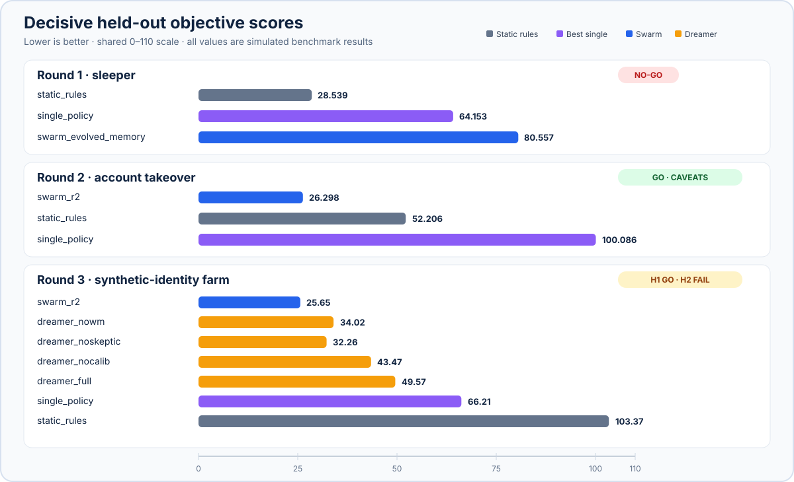
<sub>Actual objective scores from the decisive synthetic held-out tests; lower is better. Round 3 includes the dreamer ablations and the round-2 swarm for context. Each round uses a different held-out family; interpret scores with the round-specific pass rule and caveats below.</sub>
</div>

### Objective and pass rule

Fixed before any swarm result existed (D-019):

```
objective = leakage_pct + 0.5 * honest_block_rate + 1.0 * honest_unpaid_rate     (lower is better)
```

The metrics are defined in [Metrics](#metrics).

Go/no-go rule, written before any TEST number existed (D-022). On the held-out split, the primary defender passes only if all three hold:

1. Its objective is at least **3.0 lower** than `static_rules`.
2. Its objective is at least **3.0 lower** than the best single specialist. That specialist is chosen on TRAIN (it is `single_policy`), not on the test.
3. Its honest block rate is no higher than `static_rules`'.

Each round's test splits were run once, by one script, after the defender was fixed. The scripts refuse to run again while their results file exists (`eval/final/results.json`, `eval/final_r2/results.json`, `eval/final_r3/results.json`).

### Round 1: held-out sleeper family

Primary defender: `swarm_evolved_memory` (champion `g17-7`, SHA-256 `0fefe00f54942385c6a9a6a86e5ccaa14264665713c7bf9bf2e77c4ebb4dfe82`). Chosen on TRAIN only. 20 episodes per split, about 80,000 honest payouts per split. Values are copied from `eval/final/results.json` (git rev `121c8ba`). SIMULATED.

**Verdict: NO-GO.**

| Check | Split | Swarm | Static rules | Best single | Margin vs static | Margin vs single | Honest block (swarm / static) | Pass |
| --- | --- | --- | --- | --- | --- | --- | --- | --- |
| Decisive | TEST_HELDOUT (sleeper) | 80.557 | 28.539 | 64.153 | -52.019 | -16.404 | 2.835 / 9.595 | no |
| Secondary | TEST_SEEN (ring, structuring) | 17.142 | 65.639 | 70.371 | +48.496 | +53.229 | 3.085 / 9.849 | yes |

A margin is the other defender's objective minus the swarm's. A pass needs +3.0 on both.

#### TEST_HELDOUT (seeds 3000-3019, sleeper only). Decisive.

| Defender | Objective | Leakage % | Honest block % | Honest unpaid % |
| --- | --- | --- | --- | --- |
| always_release | 100.000 | 100.000 | 0.000 | 0.000 |
| always_hold | 71.453 | 11.513 | 100.000 | 9.940 |
| static_rules | **28.539** | 22.783 | 9.595 | 0.958 |
| single_policy (best single, chosen on TRAIN) | 64.153 | 63.026 | 1.989 | 0.133 |
| llm_judge_sarvam | 102.605 | 96.256 | 11.443 | 0.628 |
| llm_judge_gemini | 65.202 | 50.445 | 26.757 | 1.379 |
| swarm_frozen | 55.107 | 51.775 | 5.878 | 0.393 |
| swarm_l1 | 55.097 | 51.775 | 5.858 | 0.393 |
| swarm_evolved | 80.232 | 78.545 | 2.834 | 0.270 |
| swarm_memory | 60.017 | 56.690 | 5.866 | 0.394 |
| swarm_evolved_memory (primary) | 80.557 | 78.870 | 2.835 | 0.270 |

#### TEST_SEEN (seeds 2000-2019, ring and structuring). Secondary.

| Defender | Objective | Leakage % | Honest block % | Honest unpaid % |
| --- | --- | --- | --- | --- |
| always_release | 100.000 | 100.000 | 0.000 | 0.000 |
| always_hold | 70.040 | 10.130 | 100.000 | 9.910 |
| static_rules | 65.639 | 59.831 | 9.849 | 0.883 |
| single_policy (best single, chosen on TRAIN) | 70.371 | 69.291 | 1.871 | 0.144 |
| llm_judge_sarvam | 98.149 | 91.185 | 12.426 | 0.751 |
| llm_judge_gemini | 83.478 | 68.651 | 26.978 | 1.338 |
| swarm_frozen | 20.459 | 17.158 | 5.836 | 0.382 |
| swarm_l1 | 20.451 | 17.158 | 5.825 | 0.380 |
| swarm_evolved | 18.280 | 16.505 | 3.003 | 0.273 |
| swarm_memory | 18.493 | 15.133 | 5.946 | 0.387 |
| swarm_evolved_memory (primary) | **17.142** | 15.322 | 3.085 | 0.278 |

TRAIN rows are in `eval/final/results.json` as well. They are not evidence: the defenders were tuned on TRAIN.

#### Why round 1 failed (descriptive, no tuning on the test)

This reading comes from the table above; we did not run a new experiment on TEST data to confirm it.

- Evolution lowered honest friction (honest block 5.9% to 2.8% on the held-out split) by loosening thresholds. Sleepers pass those looser thresholds: leakage went from 51.8% for the fixed-weight swarm to 78.5% for the evolved one.
- Shared memory did not help against sleepers, because a sleeper builds a clean history first. Adding memory to the fixed-weight swarm moved it from 55.11 to 60.02 (worse), and the evolved swarm with memory (80.56) is no better than without it (80.23).
- The tuned static rules include a rule on payouts at least 2x the worker's own median. That rule happens to suit the sleeper family, which is why static rules are strong here.
- The two LLM judges are baselines, not part of the swarm. Both scored worse than static rules on the held-out split. Replayed from cache, the Sarvam judge fell back to its fixed rule on 0 payouts and the Gemini judge on at most 0.007% of payouts (its free daily quota ran out).
- The TEST data of round 1 is spent. Any new claim needs a new, never-built held-out family. That is round 2.

### Round 2: second sealed family

Decided before the round-2 defender existed (D-034, amended by D-035):

- **Family.** A second attack family (h2, see [Attack families](#attack-families)) was written by a separate worker who did not see the defender. Its code is frozen by hash in `eval/FROZEN_R2.json`, and its seeds (4000-4019, split TEST_HELDOUT2) were not built during development. A test tripwire refuses them, and a scanner test fails if any other test file names them.
- **Defender.** `swarm_r2` was designed on TRAIN only and selected by leave-one-family-out (4 folds: fit on one TRAIN family and half of the TRAIN seeds, score on the other family and the other half), with a rule written before scoring (`eval/r2/SELECTION_RULE.md`). Champion candidate `C2-bh2-bs5`, `eval/r2/champion.json` SHA-256 `fe38d6c8408c21ebdf485045c7b746b1ad9b9261a8aee1d90c4967b3b502a17e`. It was frozen (`eval/final_r2/defender_freeze.json`, git rev `03e2da4`) before any TEST_HELDOUT2 episode was built.
- **Disclosed amendment.** The selection rule was amended once, after a TRAIN-only smoke run and before the full grid (Amendment 1: an honest-block margin of 0.75 points and a 1.5-point noise band, then the most sensitive candidate). Under the original rule the pick would have been the default swarm, which is reported below as `swarm_l1`. It also passes, so the amendment did not decide the verdict.
- **Rule.** Same rule as round 1, same margins, applied to `swarm_r2` on TEST_HELDOUT2. One run, no re-runs, no tuning afterwards.
- **Gemini.** The Gemini judge row is added in a second, separate run (its free quota was spent). It cannot change any other row or the verdict: the rule reads only `swarm_r2`, `static_rules` and `single_policy`.

**Verdict: GO** (`eval/final_r2/results.json`).

| Check | Split | swarm_r2 | Static rules | Best single (TRAIN pick) | Margin vs static | Margin vs single | Honest block (swarm_r2 / static) | Pass |
| --- | --- | --- | --- | --- | --- | --- | --- | --- |
| Decisive | TEST_HELDOUT2 (h2) | 26.298 | 52.206 | 100.086 | +25.908 | +73.788 | 7.385 / 9.745 | yes |

#### TEST_HELDOUT2 (seeds 4000-4019, h2 only; 20 episodes, 83,173 payouts). Decisive for round 2.

All rows, sorted by objective:

| Defender | Objective | Leakage % | Honest block % | Honest unpaid % |
| --- | --- | --- | --- | --- |
| swarm_r2 (primary) | **26.298** | 22.085 | 7.385 | 0.521 |
| swarm_memory | 28.190 | 24.800 | 5.947 | 0.417 |
| swarm_evolved_memory (round-1 primary) | 28.849 | 27.007 | 3.085 | 0.300 |
| single_graph (best single on this split; not the rule's single) | 28.866 | 26.875 | 3.490 | 0.246 |
| swarm_l1 (strict-rule pick, see above) | 29.061 | 25.669 | 5.952 | 0.416 |
| swarm_frozen | 29.700 | 26.305 | 5.961 | 0.414 |
| swarm_evolved | 30.127 | 28.285 | 3.084 | 0.300 |
| static_rules | 52.206 | 46.349 | 9.745 | 0.984 |
| llm_judge_sarvam | 68.449 | 61.856 | 11.705 | 0.740 |
| always_hold | 69.139 | 9.032 | 100.000 | 10.107 |
| single_drift | 95.386 | 94.796 | 1.026 | 0.077 |
| always_release | 100.000 | 100.000 | 0.000 | 0.000 |
| single_policy (best single, chosen on TRAIN) | 100.086 | 99.091 | 1.751 | 0.120 |
| single_velocity | 100.851 | 100.000 | 1.501 | 0.100 |
| single_graph (best single on this split; not pre-registered) | 28.866 | 26.875 | 3.490 | 0.246 |
| llm_judge_gemini (added in a later run, D-035) | 56.774 | 42.053 | 26.563 | 1.439 |

The Sarvam judge replayed all 83,173 payouts from cache with 0 fallbacks.

`swarm_r2` on the other splits: TRAIN 20.823, TEST_SEEN 21.049, TEST_HELDOUT 45.101. The TEST_HELDOUT value is **not a clean test**, because round 1's failure on that family was known while `swarm_r2` was being designed. It is also worse than static rules there (28.539): the sleeper family is still lost.

#### Reading round 2

- `swarm_r2` passed the pre-registered rule on a second family it had never seen. This does not undo round 1. It is one family, one run, on synthetic data.
- The Graph specialist alone is close (28.87, +2.57). This family's footprint is in the payout channel (shared destinations and devices), which is the kind of structure the Graph specialist was built to see. Against the best single *on the test*, `swarm_r2` would not clear the 3.0 margin. The rule fixed the single on TRAIN to stop exactly this kind of after-the-fact choice, so the verdict stands, and we show both.
- Every round-1 swarm scores 28.2-30.1 here, against 52.2 for static rules. The round-2 layer adds 1.9-3.8 points over them, at a higher honest block rate (7.4% vs 3.1-6.0%).
- We did not analyse why static rules miss this family, and we will not tune anything on it. The two facts on record: the drains are about 1-4x the victim's own median and stay under the review threshold (design note), while the tuned static rules act at 2x the worker's median or USD 300.

### Round 3: the swarm that dreams and doubts

Pre-registered before any round-3 code existed (`docs/PREREG_R3.md`, approved by the user on 2026-11-08, D-041). The prior-art audit is in `docs/PRIOR_ART.md`. It found no direct match for this combination, but every ingredient exists elsewhere, and we do not claim to be first.

**What it adds on top of the evolution loop:**

1. **A world model of the attackers:** a posterior over each known family's attack settings, learned only from confirmed fraud with labels arriving 4-72 h late. The fit uses approximate Bayesian computation over 17 summary statistics.
2. **A dream loop:** each generation, 32 imagined attackers are drawn: half from the world model, a quarter from regions the Skeptic marks uncertain, and a quarter from recombined tactics. Every candidate defender is also scored against these dreams.
3. **A Skeptic:** it refits the model on part of the data and records where its predictions are wrong. Dreams from those regions count less.
4. **Calibrated trust:** the weight on dreams shrinks when the gains they predicted miss the gains the real gate measured.

Imagination can propose candidates but never promote them: the champion-challenger gate stays real and unchanged. The core uses no LLM.

**Development checks (TRAIN only):**

- **K2 (stability)** failed first: estimates moved by 0.057 of a range, over the 0.05 limit. With a larger reference table it passed (D-043).
- **Selection:** setting c1 won by leave-one-family-out, with a rule written before the first run (`eval/r3/SELECTION_RULE.md`).
- **K1 (does the world model help on TRAIN?)** passed, +14.55 against a 1.0 bar. But 2 of its 4 paired runs ended with identical defenders, so the margin rests on the other two. This was logged before the sealed test (D-045).

**The sealed test** (TEST_HELDOUT3, family h3, 20 episodes, 80,953 payouts, run once; `eval/final_r3/results.json`):

| Defender | Objective | Fraud leaked | Honest blocked | Arm minus full dreamer, per episode [95% CI] |
| --- | --- | --- | --- | --- |
| static_rules | 103.37 | 97.6% | 9.6% | +49.78 [+42.02, +57.39] |
| single_policy (best single, chosen on TRAIN) | 66.21 | 65.3% | 1.6% | +20.42 [+11.70, +29.74] |
| **swarm_r2** (round 2, no dreams) | **25.65** | 21.2% | 7.7% | **-24.87** [-29.88, -19.67] |
| **dreamer_full** | **49.57** | 46.9% | 4.6% | (reference) |
| dreamer_nowm (no world model) | 34.02 | 31.3% | 4.6% | -16.76 [-20.69, -12.83] |
| dreamer_noskeptic (no Skeptic) | 32.26 | 30.3% | 3.3% | -17.58 [-21.25, -13.85] |
| dreamer_nocalib (fixed trust) | 43.47 | 41.7% | 3.0% | -4.80 [-8.09, -1.87] |

The objective, leakage and block columns are pooled over all 20 episodes, and the pre-registered decision uses the pooled objective (D-042). The last column is the mean per-episode difference, with a bootstrap 95% interval (2000 resamples). Negative means that defender let less through than the full dreamer.

- **H1 (is the swarm useful at all?): GO.** The full dreamer beat static rules by 53.80 and the best single specialist by 16.64, with fewer honest blocks (4.6% vs 9.6%). On this family the bar is low: static rules let 97.6% of the fraud through.
- **H2 (do dreams add value?): FAIL.** The full dreamer was 15.55 *worse* than the same pipeline without a world model; it needed to be 2.0 better. Every ablation beat it, and so did the round-2 swarm. None of these intervals crosses zero.
- **Report only:** about 9.5 attack attempts succeeded before the full dreamer shut a campaign out, against 4.1 without a world model and 2.8 for `swarm_r2`. 10.3% of the full dreamer's farm campaigns were never contained. The calibration measure had only 3 readings per run, too few to say anything.

**Honest statement:** the swarm works, but the world model did not help; on the sealed family it hurt. Our guess, untested: the world model learns only from the two training families, so its dreams may have pushed the defender to specialise further on known attack shapes. The sealed set is spent, so this can only be tested on a new blind family, never by tuning on this one.

### LIVE rows (PayPal sandbox)

The benchmark never calls PayPal. The LIVE rail is separate (`payguard/rail/live_rail.py`): `scripts/live_run.py` sends a small sample of the payouts the swarm released as real sandbox Payouts batches, guarded by a per-payout cap, a session budget and a receiver allowlist, then waits for PayPal's signed webhooks.

- First live run: 5 sandbox payouts of USD 1.00 each (test money), all batches SUCCESS, and 15 signature-verified webhooks received for them. They paid released events of the round-1 episode (TEST_HELDOUT seed 3000); the receipts are kept in `eval/live/round1_replay_live.json`.
- Second live run (2026-11-08): 5 sandbox payouts of USD 1.00 each on the round-2 episode (TEST_HELDOUT2 seed 4000, the episode the dashboard shows), all batches and items SUCCESS, and 15 signature-verified webhooks received for them (processing, batch success and item succeeded for each batch). The paid events are 653, 736, 1515, 1823 and 2639: honest payouts the swarm released. The receipts are in `eval/replay_live.json`.
- These rows show that the rail works end to end. They are not a fraud result and are not in the tables above.

### How to reproduce

Offline, no keys, no network:

```bash
python -m pytest -q
python -m scripts.freeze                  # prints "FROZEN files match" if the benchmark is untouched
python -m scripts.freeze --round 2        # prints "FROZEN_R2 files match" if the sealed family is untouched
python -m scripts.run_baselines           # trivial bounds + static rules on every split
python -m scripts.run_swarm               # TRAIN only: baselines, single specialists, swarm
python -m scripts.final_eval --plan       # counts LLM payloads per split; makes no call and runs no defender
python -m scripts.final_eval_r2 --plan    # the same for round 2 (checks the defender freeze first)
python -m scripts.freeze --round 3        # checks the third sealed family against eval/FROZEN_R3.json
python -m scripts.final_eval_r3 --plan    # round 3 plan; --run refuses, the one shot is spent
```

The round-1 table is stored in `eval/final/results.json`, the round-2 table in `eval/final_r2/results.json` and the round-3 table in `eval/final_r3/results.json` (champion hash, git rev, every row). `python -m scripts.final_eval --run` and `python -m scripts.final_eval_r2 --run` are the one-shots; each refuses to run while its results file exists. The LLM judges replay from `data/llm_cache.jsonl` (Sarvam) and `data/llm_cache_gemini.jsonl` (Gemini), so a rerun needs no API key.

### Limits

- Simulator and attackers are our own design, and we wrote every attack family. Beating them says little about real fraud.
- Each round used one decisive family and 20 episodes. Three families are not a general result: the defender lost one, passed one, and the round-3 idea (dreams) failed on the third.
- The Graph specialist's default cluster-size threshold (4 workers) sits just above the simulator's honest small-shop size (3 workers). That is a design choice that knows the simulator.
- Online reputation learning (L1) added almost nothing measurable; the gains come from complementary specialists, from evolved thresholds (round 1) and from the honest-calibrated anomaly layer (round 2). The round-3 world model hurt.
- The console queue, the explanations and the copilot sessions show one replay episode and one sandbox account. They demonstrate the workflow, not a measured gain for human reviewers.

## 🗂 What is in the repo today

| Path | Purpose |
| --- | --- |
| `payguard/paypal_client.py` | Sandbox-only PayPal client: OAuth, create payout batch, get batch |
| `payguard/config.py` | Reads secrets from a local `.env` (never committed) |
| `scripts/smoke_paypal_payouts.py` | Day-0 gate: one real sandbox payout batch |
| `scripts/smoke_sarvam.py` | Day-0 gate: schema-valid JSON from the LLM defender |
| `payguard/sim/` | Deterministic payout simulator, attack generators, features, runner, metrics |
| `payguard/protocol.py` | Seed splits (TRAIN / TEST_SEEN / TEST_HELDOUT) and episode construction (round 2's TEST_HELDOUT2 lives in `payguard/heldout2/`) |
| `payguard/baselines/` | Trivial bounds and the static-rules baseline (a) |
| `scripts/run_baselines.py` | Prints the baseline table on the three round-1 splits |
| `scripts/tune_static.py` | One-time TRAIN-only tuning of the static baseline (`eval/static_rules_tuning.json`) |
| `scripts/freeze.py` | Freezes / verifies the benchmark files (`eval/FROZEN.json`) |
| `payguard/swarm/` | Four specialist defenders, the reputation-weighted coordinator (L1), single-specialist baselines |
| `scripts/run_swarm.py` | TRAIN-only table: baselines vs single specialists vs swarm |
| `payguard/rail/` | Payout rails: `SimRail` (simulated) and `LiveRail` (PayPal sandbox, guarded by a per-payout cap, a session budget and a receiver allowlist), a receipt store, and the signature-verified webhook `POST /webhooks/paypal` |
| `payguard/llm/` | Cached Sarvam LLM judge (baseline c) and LLM quality specialist; truth-free payload, opt-in paid calls |
| `scripts/estimate_llm_cost.py` | Offline count of the LLM calls a cold cache would need (makes no API call) |
| `payguard/api/` | FastAPI app: replay API, payout receipts, PayPal webhook, and the built dashboard |
| `web/` | React + Vite + Recharts dashboard; `web/dist` is the committed build that the API serves |
| `scripts/make_sample_replay.py` | Builds the sample replay fixture (TRAIN seed 1000, marked `synthetic_fixture`) |
| `payguard/evolve/`, `scripts/evolve.py` | Population search with co-evolving attackers and a champion-challenger gate (baseline e); lineage in `eval/evolution/` |
| `payguard/swarm/memory.py`, `scripts/run_memory.py` | Shared attack memory (baseline f) |
| `scripts/final_eval.py` | Round-1 one-shot on the test splits (`eval/final/results.json`) |
| `payguard/heldout2/` | Round 2: the sealed attack family h2 and split TEST_HELDOUT2 (frozen in `eval/FROZEN_R2.json`) |
| `payguard/robust/`, `scripts/r2_select.py` | Round 2: `swarm_r2` (honest-calibrated anomaly layer) and its TRAIN-only leave-one-family-out selection (`eval/r2/`) |
| `scripts/final_eval_r2.py` | Round-2 one-shot (`eval/final_r2/results.json`) and the replay the dashboard shows (`eval/replay.json`) |
| `scripts/llm_warm.py` | Fills the LLM caches on TRAIN under an explicit call cap (the one-shot scripts warm their own test splits, also capped) |
| `scripts/live_run.py` | Recorded live run: pays a few released replay events through the PayPal sandbox and records receipts and verified webhooks (dry run unless `--send`). `--reattach` carries recorded receipts onto a rebuilt replay without paying again, and refuses if any paid event is no longer a released payout there |
| `eval/live/` | Kept live-run receipts |
| `payguard/console/`, `scripts/build_console.py` | Ops console data: the review queue (`eval/console/queue.json`, parity-checked against the published replay), its priority order, and the three-rounds summary |
| `scripts/explain_holds.py` | Offline AI explanations with the grounding check (`eval/console/explanations.json`, cache `data/llm_cache_explain.jsonl`) |
| `payguard/copilot/`, `scripts/copilot.py` | Read-only ops copilot on the PayPal Agent Toolkit: tools, redaction, agent loop, session recording (`eval/copilot/sessions/`) |
| `payguard/dream/`, `payguard/r3eval.py` | Round 3: world model, Imaginer, Skeptic, calibrated trust, and the round-3 evaluation |
| `payguard/heldout3/`, `scripts/final_eval_r3.py` | Round 3: the sealed family h3 (frozen in `eval/FROZEN_R3.json`) and the one-shot (`eval/final_r3/results.json`) |
| `scripts/r3_k2_check.py`, `scripts/r3_dev_check.py`, `scripts/r3_freeze_arms.py` | Round-3 kill criteria, TRAIN-only selection and the defender freeze (`eval/r3/`) |
| `docs/` | Round-3 pre-registration and prior-art audit, the sealed-family design notes, the console contract |
| `tests/` | Offline tests (no network, no keys) |

## 💳 How PayPal and AI are used

**PayPal (sandbox only):**

- **Payouts API** is the action the defenders take. A released payout becomes a sandbox batch (`POST /v1/payments/payouts`), and batch and item status are polled (`GET /v1/payments/payouts/{id}`). OAuth client credentials authenticate every call, and the client refuses any host other than `api-m.sandbox.paypal.com`.
- **Webhooks:** `POST /webhooks/paypal` checks every event with PayPal's `verify-webhook-signature` API before it changes a payout receipt. The 11 payout events the handler maps are registered.
- **PayPal Agent Toolkit** (`paypal-agent-toolkit` 1.11.0, `shared` layer): the ops copilot's six read-only tools for Transaction Search, Disputes, Invoicing and Orders, run with `Context(sandbox=True)`. Two issues in the Toolkit's `list_transactions` are worked around and tested in `payguard/copilot/toolkit_tools.py`: it sends `transaction_id=None` in the query, which makes PayPal return no rows, and its default dates carry no timezone, which PayPal rejects with HTTP 400.
- **Guards:** the live rail has a per-payout cap, a session budget and a receiver allowlist. The hosted dashboard runs in replay mode and has no endpoint that sends payouts.

**AI:**

- **Self-evolving defenders:** the swarm's weights and thresholds are evolved by population search against attackers that mutate their parameters, with a champion-challenger gate. This is search, not an LLM.
- **Learned calibration (round 2):** `swarm_r2` learns its anomaly cut-offs from honest TRAIN traffic only, under fixed friction budgets.
- **LLM judges (baselines):** Sarvam `sarvam-105b-conversations` and Google `gemini-3.5-flash-lite` each decide payouts from a truth-free summary with structured output. They are baselines, not part of the swarm. Both scored worse than tuned static rules on the round-1 held-out family, and both did on round 2 as well (Sarvam 68.45, Gemini 56.77 against 52.21 for static rules; the Gemini judge blocked 26.6% of honest payouts). The Gemini row was added in a second run after the verdict (D-035) and changes no other row.
- **Explanations:** `gemini-3.5-flash-lite` writes the console's hold explanations from decision-time evidence only, and a grounding check falls back to a template on any number it cannot trace.
- **Copilot:** the same models drive the Agent Toolkit tool loop (a JSON tool-call protocol, at most 6 model calls per question, then a forced final answer).
- The project was built with Claude Code (Anthropic models) for planning, coding and review.

## 📄 License

MIT, see [LICENSE](LICENSE).
